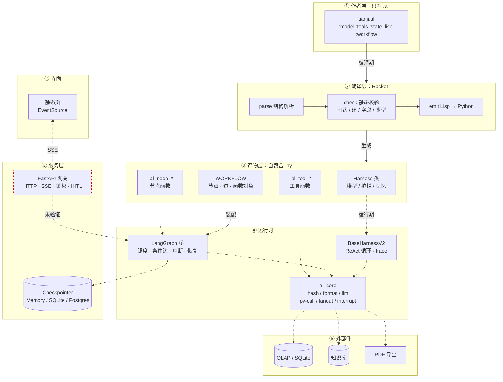
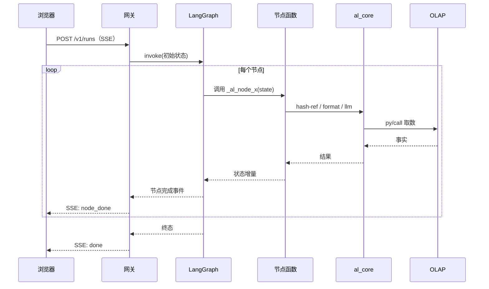

# 天玑完整实现 · 架构与技术选型

> 日期：2026-10-18
> 状态：架构定稿；⑤⑦ 两层未落地（缺什么已逐条标注）

---

## 1 结论

| 层 | 谁负责 | 现状 |
|---|---|---|
| ① 作者层（`.al`） | agentLisp | ✅ 已验证 |
| ② 编译层（Racket） | agentLisp | ✅ 852 条测试 |
| ③ 产物层（自包含 `.py`） | agentLisp | ✅ 已验证 |
| ④ 运行时（图 + Agent） | agentLisp + LangGraph | ✅ 两条路都通 |
| **⑤ 服务层（HTTP/SSE/HITL）** | **agentLisp 网关** | ⚠️ **骨架在，没接过图** |
| ⑥ 外部件（OLAP / KB / PDF） | 工具，`py/call` | ❌ 现在是假数据 |
| **⑦ 界面** | **静态页 + EventSource** | ❌ 未做 |

**准确说法：智能层 100% 用 `.al`；服务层用 agentLisp 网关；界面与数据源是外部件。**

---

## 2 总体架构



---

## 3 一次请求的时序



---

## 4 ⑤ 服务层：技术选型

### 4.1 选型表

| 关注点 | 选择 | 理由 | 备选与代价 |
|---|---|---|---|
| Web 框架 | **FastAPI** | 网关已经是它，零迁移 | Litestar（生态小）；Flask（SSE 要手搓） |
| 流式传输 | **SSE** | 单向推送，浏览器原生 `EventSource` | WebSocket（双向，但天玑不需要）；长轮询（延迟高） |
| 事件格式 | `data: {json}\n\n` | 简单、可 curl | 纯文本（前端要自己解析） |
| 鉴权 | **Bearer token**（`AGENTLISP_GATEWAY_TOKEN`） | 已实现 | mTLS（重）；JWT（要引库） |
| 人工中断 | **SSE `interrupt` 事件 + `POST /resume`** | 与 LangGraph `Command(resume=…)` 对齐 | 轮询状态（多一次往返） |
| 状态持久化 | **MemorySaver（开发）→ SqliteSaver（单机）→ PostgresSaver（多副本）** | LangGraph 原生，按部署规模升级 | 自研存储（重复造轮子） |
| 并发 | `asyncio` + 每请求独立 `thread_id` | 图本身无共享状态 | 进程池（浪费内存） |
| 可观测 | 结构化 JSON 日志 + `trace_id` | 与现有 `_log` 一致 | OpenTelemetry（重，二期） |
| 部署 | `uvicorn` 单进程起步 | 一个进程够用 | gunicorn+uvicorn worker（多核时才要） |

### 4.2 关键接口

| 方法 | 路径 | 作用 |
|---|---|---|
| POST | `/v1/runs` | 建 run，返回 SSE 流 |
| GET | `/v1/runs/{id}` | 查状态（刷新页面用） |
| POST | `/v1/runs/{id}/resume` | 人工中断后继续 |
| GET | `/healthz` | 存活探针 |

### 4.3 必须先验证的一件事

**网关能否跑 `CompiledGraph`，而不只是 harness。**

| 结果 | 下一步 |
|---|---|
| 能 | 直接接，半天工作量 |
| 不能 | 二选一：改网关（加图分支）或桥补流式接口 —— **架构决策，需要拍板** |

---

## 5 ⑦ 界面：技术选型

### 5.1 选型表

| 关注点 | 选择 | 理由 | 备选与代价 |
|---|---|---|---|
| 框架 | **原生 HTML + JS**（零构建） | 一页够用；网关直接托管静态文件 | React+Vite（要打包、要 CI）；HTMX（多一个依赖） |
| 流式 | `EventSource` | 浏览器原生，断线自动重连 | `fetch` + 手写解析（多 40 行） |
| 样式 | **原生 CSS**，不引框架 | 一页表单 + 结果区 | Tailwind（要构建）；Bootstrap（体积大） |
| 状态 | 无状态，每次请求独立 | 天玑是一次性研判 | Redux（过度设计） |
| 图表 | 先不做 | 有 `metrics` 表格就够 | ECharts（要 CDN） |

### 5.2 页面结构（单页）

```
┌─────────────────────────────┐
│ 公司 / 期间  [开始研判]      │
├─────────────────────────────┤
│ 进度：olap_facts ✓           │
│       value_judge ✓          │
│       operator_eval …        │
├─────────────────────────────┤
│ 事实表（metrics）            │
│ 三段研判（chapters）         │
│ 报告（report）  [导出 PDF]   │
└─────────────────────────────┘
```

### 5.3 为什么不用框架

| 理由 | 说明 |
|---|---|
| 一个页面 | 表单 + 进度 + 结果，无路由 |
| 无构建 | 网关直接托管，改完刷新即可 |
| 可替换 | 真要做产品界面，这一页可以整体丢掉，不影响后端 |

---

## 6 ⑥ 外部件：技术选型

| 件 | 选择 | 理由 |
|---|---|---|
| 取数 | **SQLite**（先）→ 生产 OLAP 驱动 | 真 SQL、真文件，不接生产也能验证 |
| 知识库 | 文件 + `json.loads` | 天玑的知识供给是静态片段 |
| PDF | **reportlab** | 纯 Python，无系统依赖 |
| 模型 | DeepSeek（`deepseek-v4-flash`） | 已验证；`OpenAIClient` 可换端点 |

---

## 7 五步落地顺序（每步有判据）

| # | 动作 | 判据 | 经验值 |
|---|---|---|---|
| 1 | 验证网关能否跑图 | `curl` 收到含节点名的 SSE | 0.5 天 |
| 2 | 接中断 | SSE 推 `interrupt`，`/resume` 能继续 | 1 天 |
| 3 | 换真数据源 | 改一个数，`metrics` 跟着变 | 0.5 天 |
| 4 | 静态页 | 浏览器能发请求、看流式 | 1 天 |
| 5 | PDF | 点一下出 PDF | 0.5 天 |

**合计约 3.5 天（经验值，不含调试）。**

---

## 8 三个已知风险

| 风险 | 影响 | 缓解 |
|---|---|---|
| **流式粒度只到节点** | 用户盯白屏 30 秒 | 节点内加 token 流式；二期 |
| 网关围绕 harness 设计 | 接图可能要改接口 | 第 1 步先验证 |
| 前端与 DSL 无关 | 不能算作 DSL 能力 | 文档里明确标注 |

---

## 9 一句话

**智能层用 `.al`，服务层用 FastAPI + SSE，界面用原生 HTML，数据用工具。**
```
四层各归其位，不互相越界。
